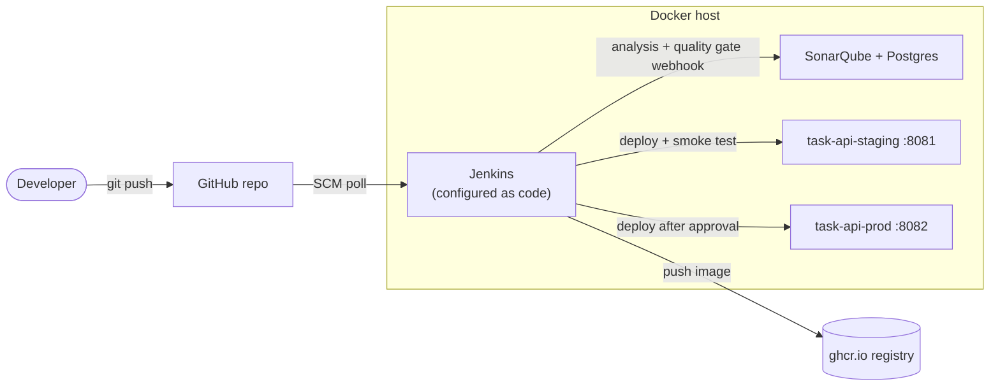
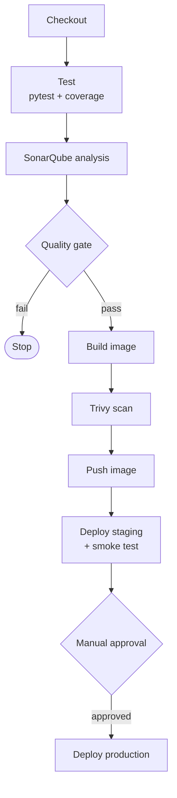

# Jenkins CI/CD Pipeline with Docker and SonarQube

A complete CI/CD setup for a small Flask API. Jenkins builds, tests, analyses, scans and deploys it, and **the Jenkins server itself is defined as code**, so the whole environment can be recreated with one command.


## Architecture



## Pipeline stages



| Stage | What it does | Fails the build when |
|---|---|---|
| Test | `docker build --target test` runs pytest inside the image build and exports coverage and JUnit reports | any test fails |
| SonarQube analysis | Scans the code and coverage with the Sonar scanner container | the scanner errors |
| Quality Gate | Waits for SonarQube's verdict through a webhook | the gate is not passed |
| Build image | Builds the small runtime image tagged `<build>-<commit>` | the build errors |
| Trivy scan | Scans the image for vulnerabilities | a fixable HIGH or CRITICAL issue exists |
| Push image | Pushes to `ghcr.io` with credentials from Jenkins (`main` only) | login or push fails |
| Deploy staging | Replaces the container, smoke tests `/health`, **rolls back to the previous image on failure** | the smoke test fails |
| Approve and deploy production | A person approves, then the same deploy script runs | not approved, or smoke test fails |

## What's in the repo

| Path | Purpose |
|---|---|
| `app/`, `tests/` | The Task API (Flask) and 8 tests with about 98% coverage |
| `Dockerfile` | Three stages: `base`, `test` (runs the tests), `runtime` (non-root, health check) |
| `Jenkinsfile` | The declarative pipeline above |
| `jenkins/` | Jenkins image with Docker CLI and plugins, plus `casc/jenkins.yaml` (Configuration as Code) |
| `docker-compose.yml` | Jenkins, SonarQube and its Postgres database on one network |
| `scripts/deploy.sh` | Deploy with smoke test and automatic rollback |
| `scripts/smoke_test.sh` | Calls `/health` from inside the Docker network |
| `scripts/bootstrap-sonarqube.sh` | One-time SonarQube setup: password, token, webhook |
| `.github/workflows/ci.yml` | Checks the repo itself: tests, image builds, shellcheck, and a real Jenkins boot plus Jenkinsfile lint |

## Run it yourself

Requirements: Docker with Compose, and about 4 GB of free RAM.

```bash
git clone https://github.com/mohd-21/jenkins-cicd-pipeline.git && cd jenkins-cicd-pipeline

# 1. Configuration
cp .env.example .env
#    set JENKINS_ADMIN_PASSWORD, and DOCKER_GID from:  stat -c '%g' /var/run/docker.sock

# 2. SonarQube needs this kernel setting on Linux
sudo sysctl -w vm.max_map_count=262144

# 3. Start SonarQube, then create its token and webhook
docker compose up -d sonarqube
SONAR_NEW_PASSWORD='choose-a-strong-one' scripts/bootstrap-sonarqube.sh
#    add the printed SONAR_TOKEN=... line to .env

# 4. Start Jenkins
docker compose up -d --build jenkins
```

Open Jenkins at http://localhost:8080 (user `admin`), SonarQube at http://localhost:9000, and run the `task-api` job. To push images, set `REGISTRY_USER` and `REGISTRY_PASSWORD` (a GitHub token with `write:packages`) in `.env`.

## Design decisions

- **Jenkins as code (JCasC and Job DSL).** Users, credentials, the SonarQube connection and the pipeline job are all in Git. Destroying and rebuilding the server loses nothing.
- **Tests run inside the Docker build.** The same Dockerfile gives developers, Jenkins and CI an identical environment, with no Python installed on the Jenkins agent.
- **No Docker-in-Docker.** Jenkins uses the host's Docker through the socket, and helper containers reuse the workspace with `--volumes-from`. This avoids path-mapping problems and keeps layer caching.
- **Quality gate blocks the pipeline.** Bad code never reaches an image, and vulnerable images never reach a registry.
- **Smoke test and automatic rollback on every deploy,** and production needs a human approval.
- **Secrets only through credentials and environment variables,** never in the repo.

## Limitations

- The Docker socket gives Jenkins full control of the host. That is fine for a lab or laptop; for production use dedicated build agents.
- GitHub Actions here validates the setup (images build, Jenkins boots, the Jenkinsfile lints) but does not run the full Jenkins pipeline. That needs a Jenkins server with Docker, SonarQube and registry credentials.
- `scripts/bootstrap-sonarqube.sh` follows SonarQube's documented web API but depends on its default `admin` login, so check it against the SonarQube version you run.
- Production here is a second container on the same host, to demonstrate the approval and rollback flow.
